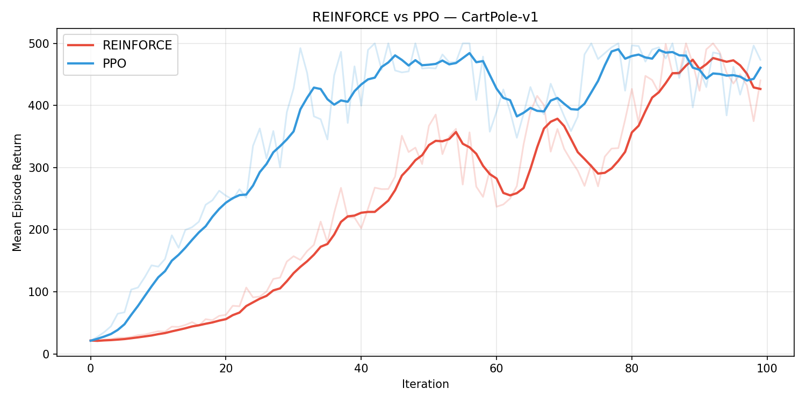
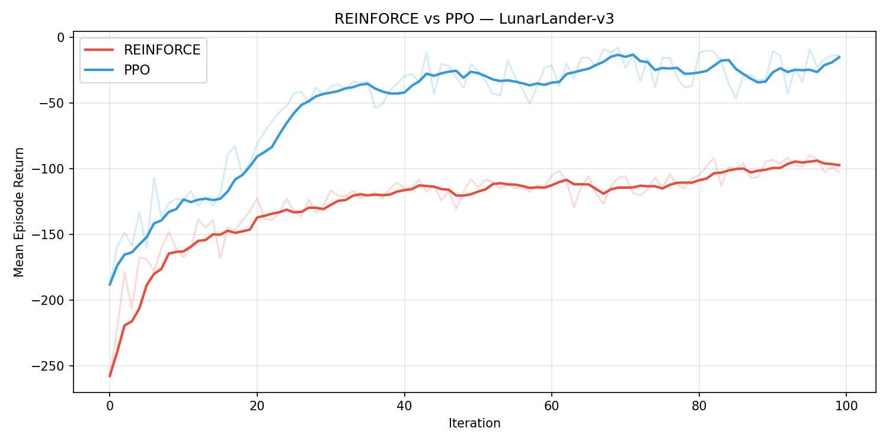
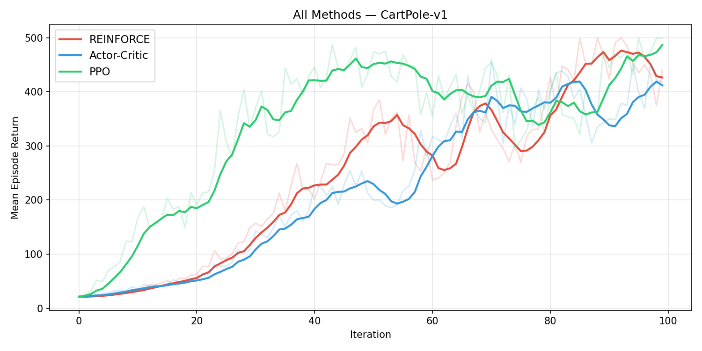
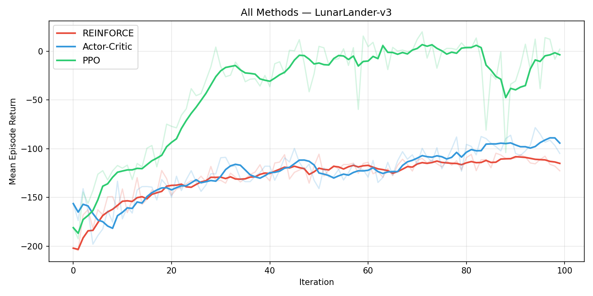
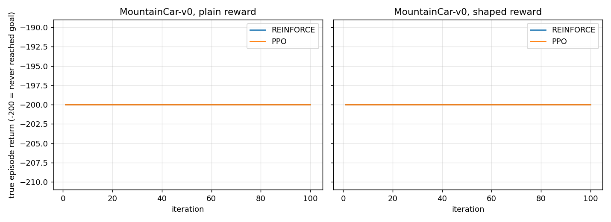
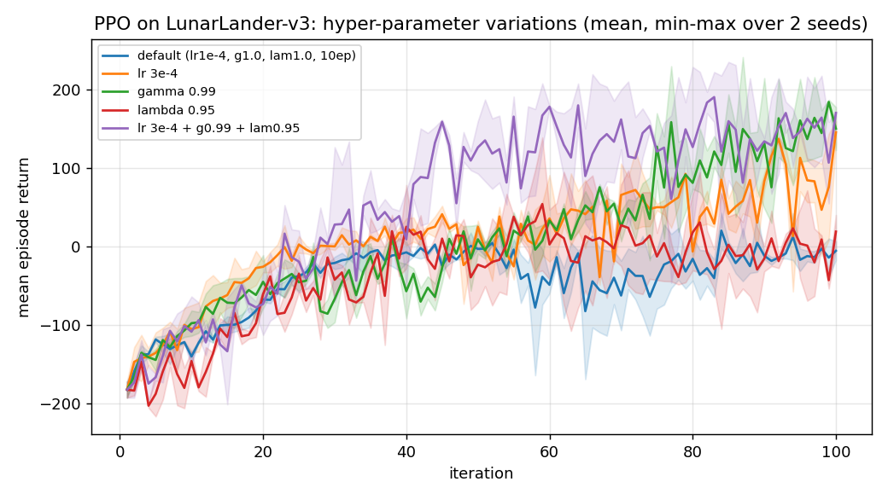

# Toy PPO: full README run, results and notes

Run on 2026-10-12 on host `nlp07` (CPU only, torch 2.10 CPU, gymnasium 1.2.3). Everything here was produced by `claude_run/run_all.sh`; logs are in `claude_run/logs/`, raw numbers in `claude_run/results/*.json`, figures in `claude_run/results/figures/`.

All five TODOs in `main.py` are the user's own implementations (`USE_SOLUTIONS = False`).

Training config (from `main.py`): 100 iterations x 4096 environment steps per rollout, gamma = 1.0, REINFORCE lr 1e-3, PPO lr 1e-4, clip 0.2, 10 epochs, minibatch 256. Seed 42 for the main run.

## 1. How the code works

`main.py` is the whole pipeline.

1. **Collect a rollout.** `collect_rollouts` calls `collect_rollout_step` 4096 times. Each call samples an action from the policy, steps the environment, and resets on `done` (`terminated or truncated`). The rollout therefore spans several episodes and may end mid-episode. It returns stacked tensors: observations, actions, log-probs, rewards, dones, value estimates, a bootstrap `last_value`, and the finished-episode returns.
2. **Turn rewards into learning signals.** `compute_returns` gives the discounted return G_t, resetting at episode ends. `compute_gae` (already provided) gives advantages A_t = sum of (gamma*lambda)^l * delta_{t+l}, where delta is the one-step TD error. It bootstraps from `last_value` at the rollout end but not across `done`.
3. **Update.** The loss differs per method (section 2). Networks are two-layer 64-unit tanh MLPs (`rl_utils.py`): a policy network that outputs action logits (a `Categorical` distribution) and a value network that outputs V(s).
4. **Log.** Each iteration's score is the mean return of the episodes that finished in that rollout. Checkpoints keep only the policy weights.

## 2. The methods

| Method | Learning signal | Update per rollout | Extra networks |
|---|---|---|---|
| **REINFORCE** | loss = -mean(log pi(a\|s) * G_t). Raw Monte-Carlo return, no baseline | one gradient step | none |
| **Actor-Critic** (extension) | same, but G_t is replaced by A_t = G_t - V(s_t) | one step for the policy, one for the value net | value net, regression to G_t |
| **PPO** | GAE advantages, normalized per batch. Loss = -mean(min(r*A, clip(r, 1-eps, 1+eps)*A)) where r = pi_new/pi_old | 10 epochs of minibatches (256) on the same rollout, grad-norm clip 0.5, loss = policy + 0.5 * value | value net (shared Adam) |

Why the order matters: REINFORCE is unbiased but high variance, since every action in an episode is credited with the whole return. A learned baseline (Actor-Critic) cuts the variance. PPO also reuses each rollout many times, which is much more sample efficient, and the clip stops those repeated steps from moving the policy too far.

## 3. The games

| Game | Task | Observation | Actions | Reward | Solved when |
|---|---|---|---|---|---|
| **CartPole-v1** | balance a pole on a cart | 4 numbers (cart position and velocity, pole angle and angular velocity) | 2: push left or right | +1 per step survived, episode cut at 500 | return 500 (the maximum) |
| **LunarLander-v3** | land a spacecraft on the pad | 8 numbers (position, velocity, angle, angular velocity, two leg-contact flags) | 4: noop, left engine, main engine, right engine | shaped: closer, slower, upright and leg contact are rewarded, fuel is penalized, crash is -100, landing is +100 | return of about 200 |
| **MountainCar-v0** (extension 6) | drive an underpowered car up a hill by rocking back and forth | 2 numbers (position, velocity) | 3: left, none, right | -1 per step, no other signal, episode cut at 200 | any return above -200 means the flag was reached |

## 4. Results per phase

### Step 3: unit tests (`python tester.py`)
5 passed, 0 failed, 0 not implemented. `collect_rollout_step`, `compute_returns`, `compute_reinforce_loss`, `compute_value_loss` and `compute_ppo_loss` all pass.

### Step 4: training (`python main.py`)
Mean return of the finished episodes in that iteration. Single seed (42), so the iteration-to-iteration swings are noise as well as signal.

| Env | Method | iter 20 | iter 40 | iter 60 | iter 80 | iter 100 | Time |
|---|---|---|---|---|---|---|---|
| CartPole-v1 | REINFORCE | 61.2 | 219.4 | 296.0 | 377.0 | 440.3 | 578 s for both methods |
| CartPole-v1 | PPO | 262.7 | 463.0 | 357.7 | 423.8 | 473.5 | |
| LunarLander-v3 | REINFORCE | -132.3 | -110.6 | -113.7 | -107.0 | -102.7 | 626 s for both methods |
| LunarLander-v3 | PPO | -95.7 | -35.1 | -22.9 | -37.0 | -13.5 | |

Plots: `results/figures/CartPole-v1.png`, `results/figures/LunarLander-v3.png`.

On CartPole both methods learn, and PPO gets there about twice as fast. On LunarLander only PPO makes real progress, and with the default settings it is still negative after 100 iterations (it has not learned to land). REINFORCE stays near -100.

### Step 9: Actor-Critic extension (`python -m extensions.actor_critic`)
This script re-trains REINFORCE and PPO as well, so its numbers differ slightly from step 4 (the random number stream is consumed in a different order, same seed).

| Env | REINFORCE | Actor-Critic | PPO |
|---|---|---|---|
| CartPole-v1, iter 100 | 440.3 | 418.6 | 500.0 |
| LunarLander-v3, iter 100 | -122.7 | -104.9 | 2.0 |

Plots: `results/figures/CartPole-v1_with_ac.png`, `results/figures/LunarLander-v3_with_ac.png`. Actor-Critic is about the same as REINFORCE on CartPole (slightly lower at iter 100, within what a single seed can swing) and slightly better on LunarLander, but far behind PPO on both. With one seed I cannot claim any ordering between REINFORCE and Actor-Critic. The PPO gap is large enough to be trustworthy.

Note the same PPO / LunarLander configuration finished at -13.5 in step 4 and +2.0 here, which gives a feel for seed noise.

### Step 5: visualization
One GIF per agent and environment in `results/figures/`. These are single episodes of the checkpoints from step 9, so each return is one sample and noisy. I did not watch the GIFs, only recorded their returns.

| Agent | CartPole-v1 | LunarLander-v3 |
|---|---|---|
| random | 23.0 | -91.1 |
| REINFORCE | 453.0 | -100.2 |
| PPO | 500.0 | -19.9 |
| Actor-Critic | 500.0 | -59.9 |

Question: *does it look like the agent learned well?* By return, CartPole yes for all three trained agents. LunarLander no: PPO is better than random but nowhere near the 200 needed to count as landed, and REINFORCE is no better than a random agent (-100 vs -91 in this one episode).

Question: *can you train better than the README GIFs?* Not at the defaults on LunarLander. With the tuned settings below, the best runs reach 177 and 187 (last 10 iterations) and cross a mean return of 200 in single iterations, which is close to solved. I did not render a GIF of a tuned agent.

## 5. Optional extensions

### Extension 6: MountainCar (`ext_mountaincar.py`)
REINFORCE and PPO with the default settings, then with a reward-shaping fix, 2 seeds each. Metric: true episode return (-200 means the goal was never reached).

| Variant | seed 0 | seed 1 |
|---|---|---|
| REINFORCE, plain | -200.0 | -200.0 |
| PPO, plain | -200.0 | -200.0 |
| REINFORCE, shaped | -200.0 | -200.0 |
| PPO, shaped | -200.0 | -200.0 |

*Does the learning work?* No, for any variant.

*Why does the plain version fail?* The reward is -1 on every step, and a randomly acting policy essentially never reaches the flag within 200 steps, because the engine is too weak to climb directly and the car has to build momentum by rocking. So every episode returns exactly -200, all actions look equally good, and the policy gradient has nothing to follow. This is an exploration problem, not an optimization problem. (Reasoning from the reward structure and the flat -200 curves. I did not run a separate diagnostic.)

*My fix did not work.* I added potential-based shaping, r' = r + phi(s') - phi(s), with phi = 10,000 x the car's mechanical energy (kinetic plus height), which rewards building momentum while keeping the optimal policy unchanged. All four shaped runs still ended at exactly -200. I did not find out why. Untested guesses: the shaping scale is too small relative to the -1 per step, a Categorical policy with this much entropy loss does not explore enough in 100 x 4096 steps, or the shaping is cancelled at gamma = 1. Other fixes worth trying, none run: an entropy bonus, a count-based or curiosity bonus, or starting episodes from random states.

### Extension 7: beat the defaults (`ext_tuning.py`)
PPO on LunarLander-v3, 5 configurations x 2 seeds. Value shown is the mean return over the last 10 iterations; "iter >= 200" is the first iteration whose mean return reached 200 (none = never).

| Configuration | seed 0 | seed 1 | mean | iter >= 200 (seed 0 / 1) | time per run |
|---|---|---|---|---|---|
| default (lr 1e-4, gamma 1.0, lambda 1.0) | -0.6 | -18.1 | -9.4 | none / none | 368 s |
| lr 3e-4 | 67.9 | 116.0 | 92.0 | none / none | 368 s |
| gamma 0.99 | 108.3 | 177.2 | 142.7 | none / 76 | 375 s |
| lambda 0.95 | -25.1 | 23.1 | -1.0 | none / none | 363 s |
| lr 3e-4 + gamma 0.99 + lambda 0.95 | 111.5 | 187.3 | 149.4 | none / 58 | 358 s |

What this supports: with only 2 seeds, a larger learning rate (3e-4) and a discount below 1 (0.99) each help a lot (about +100 and +150 over default), and combining all three is the best at 149. Both seeds agree in direction for every comparison. What it does not support: lambda = 0.95 on its own is not distinguishable from default (-1.0 vs -9.4, seeds differ by about 50), so I cannot say whether the combined run's gain comes from lambda. The best configuration has not reached 200 on average, only on the best single iterations of seed 1.

A likely reason a discount below 1 helps here, not tested: with gamma = 1 the return of a long hovering episode sums many shaped rewards, so credit for the final landing is diluted.

### Extension 8: GAE-lambda (`ext_gae.py`)
I did not erase and rewrite `compute_gae` in `main.py`. Instead I wrote an independent O(T^2) implementation (explicit sum of (gamma*lambda)^l * delta, stopping at episode ends) and compared it with the provided function on random data, T = 300, about 5% episode ends.

| gamma, lambda | max abs difference |
|---|---|
| 1.0, 1.0 | 1.4e-6 |
| 1.0, 0.95 | 1.6e-6 |
| 1.0, 0.0 | 0 |
| 0.99, 1.0 | 3.6e-6 |
| 0.99, 0.95 | 1.4e-6 |
| 0.99, 0.0 | 0 |

All agree to float32 precision. With lambda = 1 and a rollout ending on `done`, GAE also equals G_t - V(s_t) from `compute_returns` (difference 1.9e-6), as the docstring says. The effect of lambda on training is in the tuning table above.

## 6. Caveats

- Single seed for steps 4 and 9, two seeds for the extensions. Differences of a few tens of return points between methods are inside the noise.
- The step 4 and step 9 PPO runs use the same configuration and differ by 15 return points on LunarLander, as noted above.
- The main run and the two extension lanes ran in parallel on one host with 2 threads each, so the wall-clock times are not a clean speed benchmark.
- Extension runs save checkpoints to `claude_run/results/ckpt/` (git-ignored), leaving `checkpoints/` for the main run.
