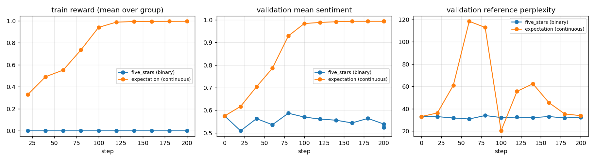
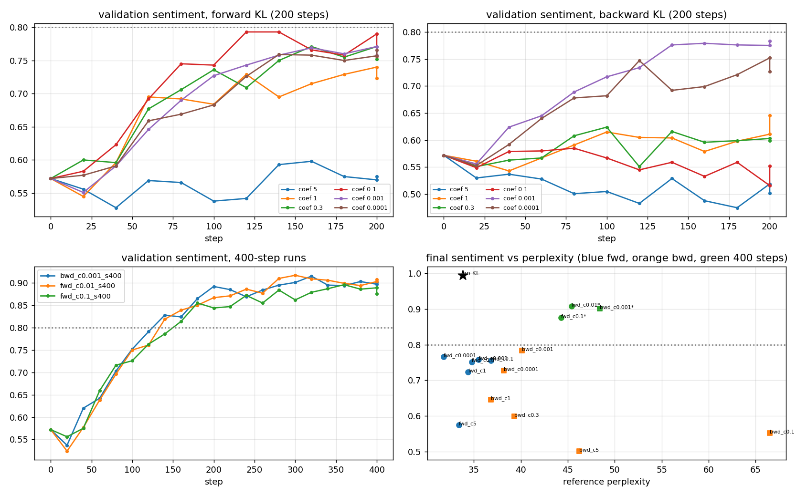
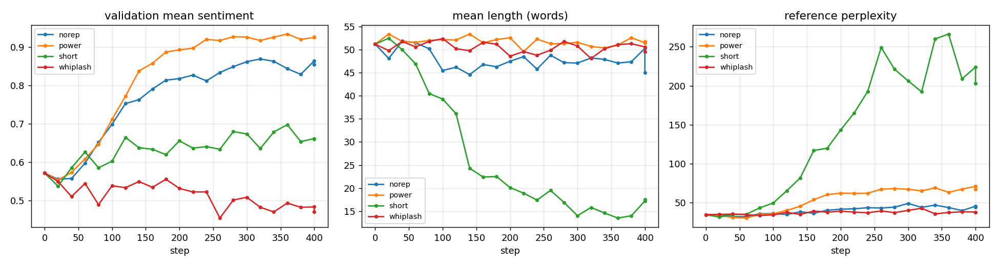
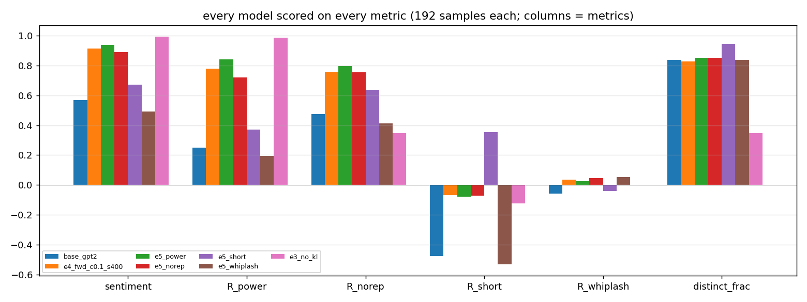
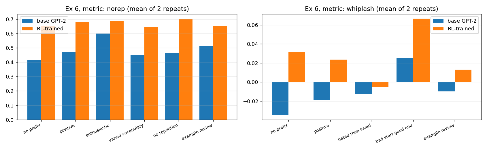

# RL sentiment exercise: answers and results (Exercises 2 to 6)

Run on 2026-10-13 on `nlp07` (GTX 1080 Ti cards, GPU 0 left free; runs used GPUs 1 to 3). Everything here comes from `claude_run/`: logs in `logs/`, raw numbers in `results/*.json`, figures in `results/figures/`, timing in `results/timing.tsv`. The code is a copy of the clean repo (`claude_run/work/`) with my own implementations of the TODOs in `work/rewards.py`. The student files in the repo root were not touched.

## 0. Setup, caveats, timing

- **Model and trainer:** GPT-2, TRL GRPO, 8 completions per prompt, batch 2 x accumulation 4, learning rate 1e-4, temperature 1.5, up to 64 new tokens, 200 steps by default. wandb off, so all curves come from the printed logs.
- **Single seed (42).** Each configuration ran once. Differences of a few hundredths in sentiment between runs are inside the noise. Validation uses 64 prompts, one sample each.
- **Precision:** the trainer picked bfloat16 on these GTX 1080 Ti cards (PyTorch reports bf16 as supported through emulation). Training worked, but it is slower than native bf16 and may differ numerically from a modern GPU.
- **Metrics:** "sentiment" is the mean expected-stars score in [0, 1] over the 64 validation prompts. "Perplexity" is how surprising the generated text is to the original GPT-2 (lower means more like normal GPT-2 text). "First-token perplexity" uses only the first 2 generated tokens.
- **My implementations** (all checked against `rewards_solution.py`: identical numbers on the test inputs):
  - `expected_stars`: sum of probability x star (1 to 5), rescaled to [0, 1].
  - `kl_penalty_forward`: coefficient x mean over tokens of (log pi - log pi_ref).
  - `kl_penalty_backward`: coefficient x mean over tokens of w * log(ref/pi) with importance weight w = ref/pi (log ratio clamped to +-20).
  - `shaped_reward`: five variants chosen by an environment variable (Exercise 5).

### How long each phase took

All times are wall clock on this host. Runs in a phase went in parallel, one process per GPU. "Sum" is the GPU time added up across runs.

| Phase | What | Runs | Time per run | Wall time | Sum of runs |
|---|---|---|---|---|---|
| Dry run | 20 steps, check the pipeline | 1 | 1.3 min | 1.3 min | 1.3 min |
| Exercises 2, 3, 4 (first grid) | five_stars, expectation, forward/backward KL at 5, 1, 0.3, 0.1 | 10 | 7.5 to 9.7 min | 33.5 min (the first run alone for 8 min, then 3 GPUs) | 83 min |
| Exercise 4, smaller coefficients | KL at 0.001 and 0.0001, both types | 4 | 7.7 to 8.6 min | 16.2 min | 32 min |
| Exercise 4, longer training | 400 steps at three settings | 3 | 15 min | 15.2 min | 45 min |
| Exercise 5 | four shaped rewards, 400 steps | 4 | about 15 min | 29.8 min (3 GPUs, so one GPU ran two) | 60 min |
| Exercise 5 scoring | generate and score every model on every metric | 2 jobs | 0.7 to 2.5 min | about 3 min | 3 min |
| Exercise 6 | prompt engineering vs RL, 2 metrics x 2 repeats | 4 | 7 min each | 28.8 min (one GPU) | 29 min |
| **Total** | | **28** | | **about 1 h 55 min from the first launch (16:25 to 18:20)** | **252 min** |

Installing the environment and writing the scripts are not included in these numbers.

---

## Exercise 2: sparse reward (`--reward_shaping five_stars`)

**Result: the model does not learn.**

| step | 0 | 40 | 80 | 120 | 160 | 200 |
|---|---|---|---|---|---|---|
| validation sentiment | 0.575 | 0.563 | 0.587 | 0.561 | 0.544 | 0.539 |
| positive outputs | 61% | 62% | 70% | 56% | 58% | 58% |
| perplexity | 33.1 | 31.8 | 34.0 | 32.6 | 33.1 | 32.5 |



**Why?** The training reward (WandB hint) is exactly 0.0 at every logged step, and the fraction of groups where all 8 completions got the same reward is 1.0 every time. The reward is 1 only if the sentiment model gives 5 stars with probability at least 0.9, and base GPT-2 almost never writes text like that at temperature 1.5. GRPO ranks the 8 completions of a prompt against each other. When all 8 get 0, every advantage is 0, so the gradient is zero and the weights do not move. The wobble in the validation numbers (0.54 to 0.59) is sampling noise around the original model. This is the sparse-reward problem: no reward signal means no learning, however long you train.

## Exercise 3: non-sparse reward (`expectation`)

**Result: the model learns the reward very quickly, and the text turns into nonsense.**

| step | 0 | 40 | 80 | 120 | 160 | 200 |
|---|---|---|---|---|---|---|
| train reward | 0.33 (step 20) | 0.49 | 0.73 | 0.99 | 1.00 | 1.00 |
| validation sentiment | 0.575 | 0.704 | 0.929 | 0.989 | 0.994 | 0.994 |
| positive outputs | 61% | 97% | 100% | 100% | 100% | 100% |
| perplexity | 33.1 | 61.0 | 112.8 | 55.6 | 45.6 | 33.9 |
| first-token perplexity | 86.8 | 170 | 244 | 832 | 11,729 | 2,504 |

- **Did it learn to be positive? Compare with Exercise 2.** Yes: sentiment goes from 0.58 to 0.99 within about 120 steps, against no change in Exercise 2. The continuous reward gives every group of 8 a ranking: the reward std inside groups is 0.15 to 0.19 early on, so there is a gradient. (It later falls to about 0.001 after step 120, once every completion scores near 1.) The binary reward gave no ranking at all.
- **Do the outputs look like natural language? What goes wrong?** No. Typical final outputs: "absolutely amazing and incredibly fantastic and absolutely amazing. and very incredibly wonderful. truly and truly beautiful…", "incredible and incredible and absolutely wonderful. wonderful and wonderfully wonderful…". The model found that a stream of superlatives scores near 5 stars and stopped writing about anything. This is reward hacking: the reward only measures sentiment, so nothing asks for fluent, on-topic text. Only 35% of the words in these outputs are distinct, against 84% for base GPT-2 (section "Exercise 5 scoring" below).
- **Would you expect the perplexity to be high or low? Does the metric match?** From the outputs I would expect it to be high, because the text is far from anything GPT-2 would write. The measured mean perplexity at the end is low (33.9, the same as the untrained model's 33.1), which does not match. The reason is in the last row: the first-token perplexity is huge (2,504, and 11,729 at step 160). The first words ("absolutely", "incredible") are very surprising to the original GPT-2, but once the model starts repeating the same few positive words, every later token is very predictable, and that long predictable tail dominates the average over about 55 tokens. So mean perplexity is a poor detector of this kind of degeneration, and first-token perplexity is the more honest signal. During training the mean perplexity rose to 113 and came back down as the repetition got more extreme.

## Exercise 4: KL regularization

I implemented the forward and backward penalties and ran each at 200 steps for coefficients 5 (the default), 1, 0.3, 0.1, 0.001 and 0.0001 (you asked for the small ones), then ran the three best settings for 400 steps because nothing reached the 0.8 target in 200.



**All runs, final validation numbers** (best = highest sentiment seen at any validation step):

| Run | Final sentiment | Best | Perplexity | First-token perplexity | Words | Positive |
|---|---|---|---|---|---|---|
| no KL (Exercise 3) | 0.994 | 0.994 | 33.9 | 2,504 | 55.7 | 100% |
| forward 5 | 0.575 | 0.598 | 33.4 | 87 | 51.5 | 70% |
| forward 1 | 0.723 | 0.740 | 34.4 | 93 | 51.6 | 94% |
| forward 0.3 | 0.752 | 0.771 | 34.8 | 115 | 51.2 | 88% |
| forward 0.1 | 0.756 | 0.793 | 36.8 | 114 | 49.8 | 92% |
| forward 0.001 | 0.758 | 0.771 | 35.5 | 99 | 49.3 | 95% |
| forward 0.0001 | 0.766 | 0.766 | 31.8 | 85 | 48.0 | 91% |
| backward 5 | 0.502 | 0.572 | 46.2 | 72 | 55.1 | 48% |
| backward 1 | 0.646 | 0.646 | 36.8 | 111 | 55.8 | 75% |
| backward 0.3 | 0.599 | 0.624 | 39.3 | 70 | 55.4 | 75% |
| backward 0.1 | 0.552 | 0.585 | 66.5 | 77 | 52.8 | 64% |
| backward 0.001 | 0.783 | 0.783 | 40.1 | 78 | 50.5 | 97% |
| backward 0.0001 | 0.727 | 0.752 | 38.2 | 81 | 53.2 | 92% |
| **forward 0.1, 400 steps** | **0.876** | 0.896 | 44.3 | 144 | 49.5 | 98% |
| **forward 0.01, 400 steps** | **0.908** | 0.917 | 45.4 | 88 | 49.6 | 100% |
| **backward 0.001, 400 steps** | **0.901** | 0.915 | 48.4 | 134 | 51.1 | 100% |

- **Is the learned model highly positive? Does it write sensibly?** With the right settings, yes to both. The 400-step runs reach 0.88 to 0.91 mean sentiment (the 0.8 target) with 98 to 100% positive outputs, and the text is fluent English that reads like web copy about a film or product, for example "a beautifully made movie that really highlights the art of cinematography" and "so good I cannot stress enough the value it has…". The perplexity is 44 to 48 and the first-token perplexity 88 to 144, against 2,504 without KL. So they sit far from the Exercise 3 collapse, though not as close to GPT-2 as the 200-step runs (about 32 to 40). The text is fluent but often drifts off topic (product or news style), and a few outputs are repetitive. I did not measure quality beyond perplexity and reading samples.
- **The default coefficient (5) is too strong.** The penalty is the coefficient times the mean per-token KL, and the reward range is only [0, 1]. A coefficient of 5 makes even small drift cost more than any sentiment gain, so the model barely moves: forward 5 stays at 0.58, backward 5 at 0.50 (it even moves away from positive). This matches the README hint that the default is very conservative.
- **Forward vs backward.** In my runs forward KL behaves more smoothly: at every coefficient from 5 down to 0.0001 it ends between 0.58 and 0.77 and rises steadily with weaker regularization, with perplexity 32 to 37. Backward KL is erratic: it is worse than forward at 5, 1, 0.3 and 0.1 (down to 0.55 with perplexity 66.5 at 0.1), but beats it at 0.001 (0.783 vs 0.758). A plausible reason (not tested) is that the backward estimate multiplies the log ratio by an importance weight ref/pi, which has heavy tails, so a few tokens dominate and the penalty is noisy. With one seed per setting I would not claim a ranking beyond "forward was smoother here".
- **Tuning the coefficient.** Going from 5 down to about 0.3 helps a lot, below that the gain stops: in 200 steps forward KL plateaus at 0.75 to 0.77 for any coefficient from 0.3 to 0.0001. What got over 0.8 was training longer (400 steps), not a smaller coefficient: the 400-step runs were still slowly rising and gave 0.88 to 0.91 for coefficients from 0.1 down to 0.001. Best trade-off in my runs: forward KL 0.1 at 400 steps (0.876 sentiment, perplexity 44.3). Forward 0.01 gave a higher sentiment (0.908) at similar perplexity (45.4), but I used 0.1 for Exercise 5 because it keeps the closest tie to the original model of the three (perplexity 44.3, the lowest of the 400-step runs) while still passing 0.8. The choice was a judgment call, not a result of a comparison.

## Exercise 5: reward shaping

All runs: `--reward_shaping custom`, forward KL 0.1, 400 steps, `SHAPE_MODE` selects the shaping. The comparison baseline is plain `expectation` with the same KL and steps (Exercise 4, forward 0.1, 400 steps). `s` = expected-stars score in [0, 1].

| Name | Reward | Idea |
|---|---|---|
| `power` | s^3 | numeric transform: only strongly positive text earns much |
| `short` | s - 0.02 x (number of words) | length penalty |
| `norep` | s x (distinct words / words) | repetition penalty |
| `whiplash` | sentiment of the second half of the text minus sentiment of the first half | negative start, positive end |



**Training logs** (final validation, 64 prompts):

| Run | Train reward (first to last) | Sentiment | Perplexity | First-token perplexity | Mean words | Positive |
|---|---|---|---|---|---|---|
| baseline (expectation) | n/a | 0.876 | 44.3 | 144 | 49.5 | 98% |
| `power` | 0.06 to 0.61 | 0.927 | 67.2 | 384 | 51.8 | 100% |
| `norep` | 0.29 to 0.73 | 0.855 | 43.9 | 106 | 45.0 | 100% |
| `short` | -0.61 to 0.58 | 0.660 | 202.7 | 662 | 17.5 | 84% |
| `whiplash` | -0.01 to 0.16 | 0.471 | 37.5 | 118 | 49.6 | 47% |

**Every model scored on every metric** (192 samples each = 64 prompts x 3, same sampling as validation; each column is one metric, and the best value in a column is the model you would expect to be trained for it):



| Model | sentiment | R power | R norep | R short | R whiplash | distinct-word share | words |
|---|---|---|---|---|---|---|---|
| base GPT-2 | 0.568 | 0.250 | 0.475 | -0.478 | -0.059 | 0.839 | 52.3 |
| expectation + KL (baseline) | 0.914 | 0.780 | 0.757 | -0.068 | 0.035 | 0.830 | 49.1 |
| `power` | 0.937 | **0.842** | **0.797** | -0.079 | 0.024 | 0.851 | 50.8 |
| `norep` | 0.889 | 0.721 | 0.757 | -0.072 | 0.046 | 0.852 | 48.0 |
| `short` | 0.671 | 0.371 | 0.636 | **0.355** | -0.039 | **0.947** | **15.8** |
| `whiplash` | 0.491 | 0.193 | 0.412 | -0.533 | **0.051** | 0.838 | 51.2 |
| no KL (Exercise 3) | 0.995 | 0.986 | 0.345 | -0.122 | 0.000 | 0.347 | 55.9 |

**Which metrics learned well, and which were harder?**

- **`power`: learned best, but it moved the model furthest.** Sentiment reached 0.93 with 100% positive outputs, and it has the best score on its own metric (0.842). Cubing the score makes only strongly positive text valuable, which is the same direction as the original reward, so the gradient points the same way and it learns fast. Cost: perplexity 67 and first-token perplexity 384, both the highest of the runs that did not collapse, so it drifted more than the baseline (44, 144). It also scored best on the `norep` metric (0.797), because it is also very positive.
- **`norep`: learned, but not better than the baseline.** The training reward rose from 0.29 to 0.73 and the text stayed natural (perplexity 43.9), but on the `norep` metric it scores 0.757, the same as the plain-KL baseline (0.757), and below `power` (0.797). Its share of distinct words (0.852) is only slightly above the baseline (0.830). The KL term already keeps the model from the repetition collapse, so the extra penalty adds little here. One seed, so I would call this "no measurable gain", not "no gain".
- **`short`: learned the length, and broke the text.** Mean length fell from 51 to 16 words (R short from -0.48 to 0.36), but the cost is large: perplexity 203, first-token perplexity 662, and sentiment fell to 0.66. Samples show strings of concatenated word fragments (for example "incredible!"•WatchingTroubledLifeInChicago…") that the model exploits to end an episode cheaply. Two reasons it was hard to optimize cleanly: the length penalty (0.02 per word, up to about 1.3) is larger than the whole sentiment range, so it dominates, and the model's easiest path to a short output is to drift into odd tokens, which the KL term (coefficient 0.1) did not stop. A smaller length weight or a stronger KL would probably help (not tested).
- **`whiplash`: hardest.** Training reward rose only from -0.01 to 0.16, and the final model scores 0.051 on its own metric against 0.035 for the plain baseline and -0.059 for base GPT-2, a gap I cannot separate from noise. Side effect: the model's overall sentiment fell to 0.47 (47% positive), because the reward gives credit for a negative first half. Why it is hard: (a) the reward compares two noisy sentiment scores, so its variance is high; (b) the signal depends on the position of tokens in the text, not on what the text says, which is much harder for a policy-gradient method to assign credit for; (c) changing the first half to be more negative also changes how the second half reads.

Overall: rewards that agree with the sentiment direction (`power`) are easy, rewards that add a separate demand to a fluent text (`norep`) are learned but barely beat the KL-regularized baseline, and rewards that fight the sentiment signal or need structure within the text (`short`, `whiplash`) are hard and can cause new failures. All of this is from one seed per configuration.

## Exercise 6: RL vs prompt engineering

I picked two metrics from Exercise 5: **`norep`** (RL learned it, so a fair test) and **`whiplash`** (RL learned it weakly, but a prompt could plausibly state the pattern directly). For each, `PROMPT_STRATEGIES` has several prefixes (with "no prefix" as baseline), and `prompt_engineering.py --use_shaped_reward --trained_model ...` scores base GPT-2 and the RL model of that metric with each prefix. Each setting ran twice (64 prompts, one sample each, 50 new tokens) and the table shows the mean of the two repeats. The two repeats differ by up to about 0.04 for the same cell, so differences below about 0.05 are not reliable. Note that the scorer in `prompt_engineering.py` scores the text including the original prompt, with only the prefix removed.



**Metric `norep`** (sentiment x distinct-word share; repeat values in brackets):

| Prefix | Base GPT-2 | RL-trained (`norep`) |
|---|---|---|
| no prefix | 0.415 (0.42, 0.41) | 0.653 (0.65, 0.66) |
| "Positive review: " | 0.471 (0.48, 0.46) | 0.679 (0.68, 0.68) |
| "I absolutely loved this movie! " | **0.599** (0.60, 0.60) | 0.688 (0.67, 0.71) |
| "Positive review with rich, varied vocabulary: " | 0.449 (0.45, 0.45) | 0.649 (0.65, 0.65) |
| "Write a glowing movie review without repeating any words. " | 0.465 (0.45, 0.48) | **0.702** (0.70, 0.70) |
| "Review: A moving, original film with superb acting, a clever script and stunning visuals. Review: " | 0.515 (0.51, 0.52) | 0.655 (0.67, 0.64) |

**Metric `whiplash`** (second half minus first half):

| Prefix | Base GPT-2 | RL-trained (`whiplash`) |
|---|---|---|
| no prefix | -0.035 (-0.04, -0.03) | 0.032 (0.01, 0.05) |
| "Positive review: " | -0.019 (0.00, -0.04) | 0.024 (0.02, 0.03) |
| "I hated the first half of this film, but then it turned into something wonderful. " | -0.013 (-0.01, -0.01) | -0.005 (0.03, -0.04) |
| "Write a review that starts negative and ends positive. " | 0.025 (0.01, 0.04) | **0.067** (0.05, 0.08) |
| "Review: The first act was dull and clumsy, but the finale was brilliant and moving. Review: " | -0.010 (0.01, -0.03) | 0.013 (0.02, 0.01) |

**Summary of findings**

- **RL vs prompt engineering on `norep`.** RL wins clearly. Base GPT-2 with the best prefix reaches 0.599 ("I absolutely loved this movie!"), while the RL model with no prefix already reaches 0.653. The best prompt gains +0.18 over no prefix (0.415), and RL gains +0.24 with no prompt at all.
- **They work together, a little.** The RL model with a prompt reaches 0.702 ("Write a glowing movie review without repeating any words."), the best number overall, +0.05 over RL alone and +0.29 over untouched GPT-2. That +0.05 is about the size of the repeat-to-repeat noise, so I would call it "possibly a small gain, not shown".
- **Which prompts helped?** For base GPT-2 the plain positive prefixes helped most ("I absolutely loved this movie!" +0.18), and the prompts that ask for the second ingredient did much less. The "varied vocabulary" prefix (0.449) and the "no repetition" instruction (0.465) are roughly at the level of "Positive review:" (0.471). The model does not follow the instruction to avoid repeating words.
- **On `whiplash` nothing is conclusive.** Every value lies between -0.04 and 0.08, with repeat noise of about 0.03 to 0.07, so no prefix and no model can be separated from "no prefix" with confidence. The suggestive pattern is that "Write a review that starts negative and ends positive." is the best prefix for both models (0.025 base, 0.067 RL), and the RL model is above base in most rows. The in-context example ("I hated the first half… but then…") did not help (-0.013 base, -0.005 RL). I would not claim more than that.
- **Where prompt engineering falls short.** (1) It can only steer toward things the base model already does when asked in a "natural" way; positive sentiment is easy (the text type "review" is common), structure inside the text (negative then positive) or a ban on repeating words is not. (2) It is fragile: wording changes results by 0.1 or more, and I found the better prefix only by trying several. (3) The effect is capped: the best prompt on base GPT-2 (0.599) is below RL with no prompt (0.653).
- **Why is prompting especially hard for GPT-2?** It is a base model, not instruction-tuned. It continues text rather than following a request, so an instruction like "Write a glowing review without repeating any words." is just more text to continue, and it plausibly continues it as the start of some other text instead of writing a review (I did not inspect this). The prompts that work are the ones that look like the beginning of a text the model has seen (for example "I absolutely loved this movie!"), not commands.
- **Did RL plus prompting beat each alone?** On `norep` the combination is the best cell in the table (0.702) but beats RL alone by about the noise level; it beats prompting alone clearly (0.599). On `whiplash` the combination is also nominally best (0.067) but within noise.

## Reproducing

```bash
# from claude_run/, GPU index 1 to 3 (never 0); one process per GPU
bash lane.sh 1 phase1 "e3_expectation|--reward_shaping expectation"
SHAPE_MODE=norep bash lane.sh 3 phase5 "e5_norep|--reward_shaping custom --kl_type forward --kl_coef 0.1 --max_steps 400"
python analyze.py          # parses logs, writes results/all_runs.json and the figures
```

Training logs: `logs/e*.log`. Model weights (5.5 GB, git-ignored): `runs/*/final`.
