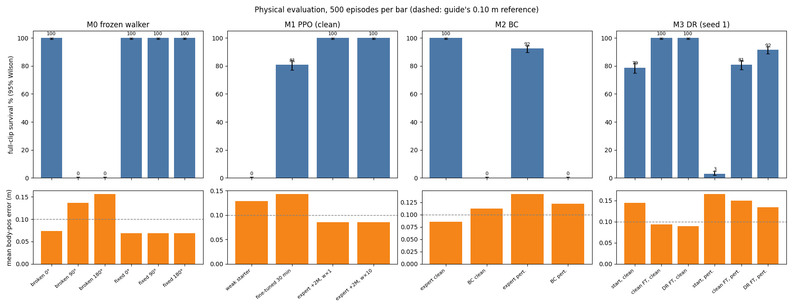
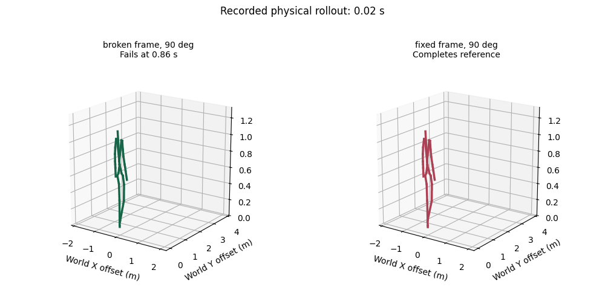
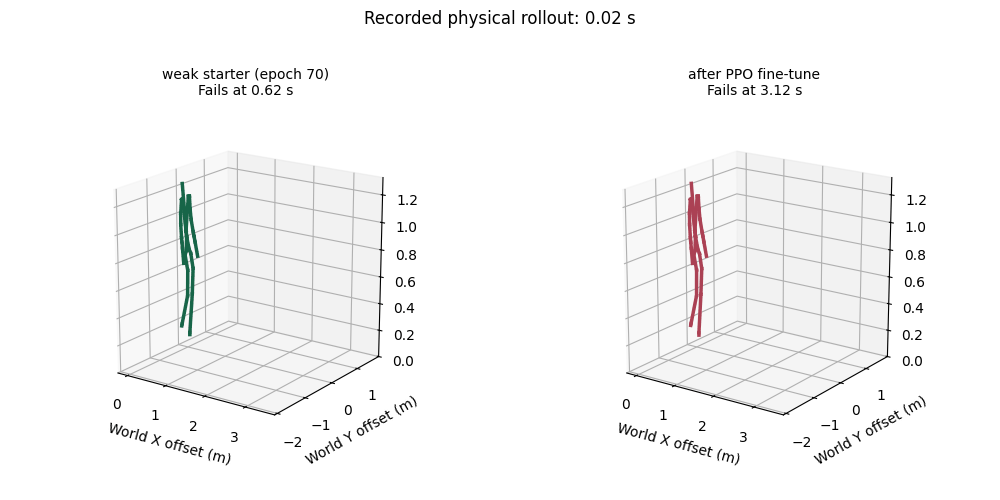
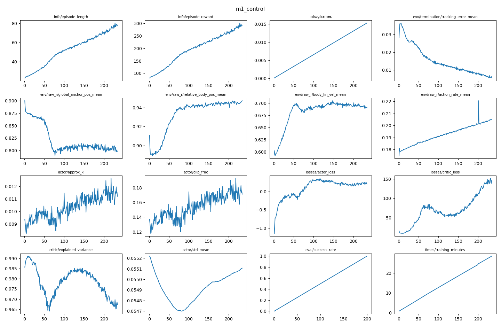
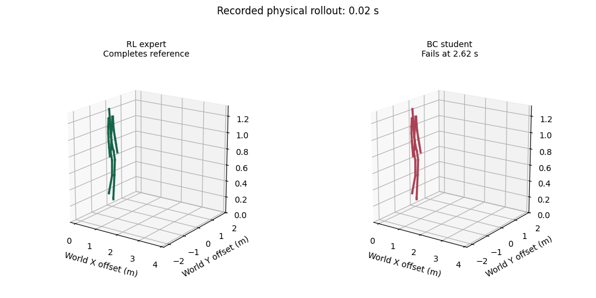
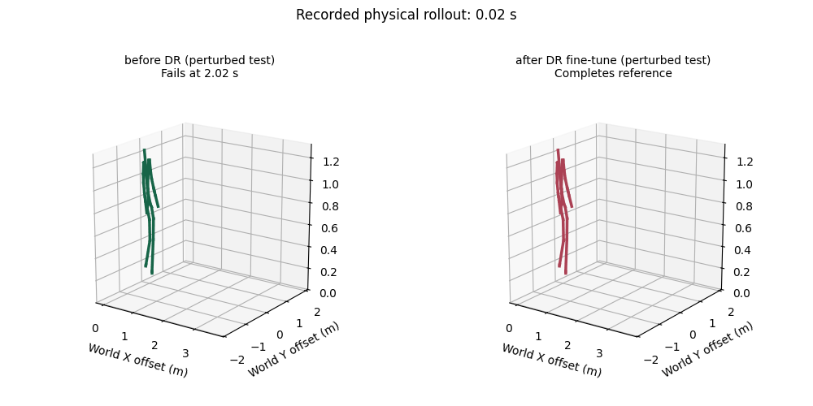

# Robotics RL course: Claude's end-to-end run (M0–M3 + Metatron)

Run on 2026-10-15 in `claude_run/work/`, a private copy of the course. Your files in `course/` are untouched.
Every number below is a physical evaluation in Isaac Sim (PhysX): 500 episodes, 128 environments, the guide's seeds, unless noted.



## Headline results

| Module   | Question                                          | Result                                                                                                                                                                                                        |
| -------- | ------------------------------------------------- | ------------------------------------------------------------------------------------------------------------------------------------------------------------------------------------------------------------- |
| M0       | Do the inputs mean what the policy expects?       | Broken frame: 100% survival at 0°, **0% at 90° and 180°**. Heading-frame fix: **100% at all three headings**, identical error (0.069 m).                                                       |
| M1       | Can PPO turn a weak tracker into a walker?        | Weak starter 0% (always falls at step 31). After 30 min of PPO: **80.8% [77.1, 84.0]**, but error 0.143 m, above the guide's 0.10 m reference.                                                          |
| M1 opt.  | Does a 10× action-rate penalty change behaviour? | Not measurably at the 2M-transition budget: survival 100% in both runs, error 0.0851 vs 0.0852 m, action changes −4%.                                                                                        |
| M2       | Does copying the expert produce a controller?     | Offline validation MSE is 1,400× below the constant-action baseline (6.0e-6 vs 8.6e-3), yet the **BC student survives 0/500** (expert: 500/500).                                                       |
| M3       | Does randomised training help under disturbances? | Perturbed survival: start 3.0%, clean fine-tune **81.0%**, DR fine-tune **91.6%**. Most of the gain comes from more training; DR adds about 10 points on top. Clean tracking is unchanged (100%). |
| Metatron | Hurdle playground (default goals, 5 episodes)     | Crossed 5/5, passed 2/5 (one clearance of −1 mm, one bar strike and fall, one fall after landing).                                                                                                           |

## 1. What the repository is

A student edition of NVIDIA's **ProtoMotions** framework (v3.1.0), cut down to one robot (Unitree G1, 29 actuated joints) and one walking clip (`course/data/walking/robot.motion`, 161 control steps ≈ 3.2 s).

| Part                          | Role                                                                                                                                                                                                                                                                                                                      |
| ----------------------------- | ------------------------------------------------------------------------------------------------------------------------------------------------------------------------------------------------------------------------------------------------------------------------------------------------------------------------- |
| `protomotions/`             | The framework: simulator abstraction (IsaacLab/PhysX here; Newton, MuJoCo and Genesis backends exist), env "MDP components" (observations, rewards, terminations as factories), PPO agent with an asymmetric actor/critic, motion library, rotations utilities.                                                           |
| `course/bm_tracker.py`      | The tracking recipe used by M1–M3, adapted from BeyondMimic (arXiv 2508.08241): reduced actor observations, privileged clean critic inputs, 3×256 MLPs, `max_episode_length=300`, raw squared action-rate penalty (−0.1), tracking-error termination at 0.5 m.                                                       |
| `course/launch.py`          | Wraps `protomotions/train_agent.py`. `launch 1 train` warm-starts from the weak epoch-70 candidate by default. `launch 3` points at the **same** M1 experiment file. Wall-clock caps: 30 min (M1), 15 min (M3), 90 min (other).                                                                               |
| `course/physical_eval.py`   | The measurement tool: N exact episodes, per-episode JSON (survival steps, failure vs censored, mean/max body-position error, squared action change, root displacement), Wilson 95% interval, SHA-256 of checkpoint and motion. `--perturbed` applies `evaluation_conditions.py`. `--bc-model` swaps only the actor. |
| `course/module_*`           | The four exercises (below). Each module has an `index.html` guide.                                                                                                                                                                                                                                                      |
| `course/render_rollouts.py` | Animates two recorded rollouts side by side (`--record-trajectory` reports): the course's way to "keep a video" without a display.                                                                                                                                                                                      |
| `course/metatron_hurdles/`  | Optional playground: a frozen jumping policy with goal planning.                                                                                                                                                                                                                                                          |

How M0–M3 connect: M0 uses a different, full-body-state walker (`pretrained/m0`). M1 trains the reduced-observation tracker. M2 imitates the **supplied** M1 expert (`pretrained/m1`), not your fine-tune. M3 fine-tunes your M1 policy (or the supplied expert as a fallback) with domain randomisation, through the same experiment file.

## 2. What I implemented (the TODOs)

Only four files differ from your copy:

```python
# M0  course/module_0_hello_world/exercises.py
heading_inv = rotations.calc_heading_quat_inv(root_rotation, w_last=True)
return rotations.quat_rotate(heading_inv, velocity, w_last=True)

# M1  course/module_1_train_no_dr/experiment.py  (design_tracking)
return cfg            # unchanged recipe; optional ablation multiplies cfg.reward_components["action_rate"] weight
# M3  same file
DOMAIN_RANDOMIZATION = True
apply_randomization(robot_cfg, simulator_cfg, **RANDOMIZATION_SETTINGS)   # after configure_clean

# M2  collect_data.py: actor_in_keys only, .detach().cpu().clone() before env.step, episode IDs; save the 6 keys
# M2  train_bc.py
train_idx, validation_idx = split_trajectories(dataset["episode_ids"])
loss = loss_fn(pred, actions[idx])
```

Checks: M0 unit tests 3/3 pass; `check_wiring` passes with the flag on; the BC split is trajectory-disjoint (90 train / 22 validation trajectories, overlap 0).

## 3. Results and analysis

### M0: repairing the observation frame (no training)

| Heading | Broken (world-frame velocity)             | Fixed (heading-frame velocity) |
| ------- | ----------------------------------------- | ------------------------------ |
| 0°     | 100% [99.2, 100], error 0.074 m           | 100%, error 0.069 m            |
| 90°    | **0%**, all 500 fall, mean 43 steps | 100%, error 0.069 m            |
| 180°   | **0%**, all 500 fall, mean 34 steps | 100%, error 0.069 m            |



- **Why 0° works with the bug:** at 0°, world axes and the robot's heading axes coincide, so the wrong code happens to give the right numbers.
- **The guide's example:** the robot faces +Y and walks at (0, 1, 0) m/s. The broken code tells the policy "1 m/s **to your left**, no forward speed". The policy corrects for a sideways drift that isn't happening and falls within ~0.9 s. At 180° it is told it is walking backwards, and falls even faster (34 steps).
- **The fix changes inputs, not weights:** the policy learned "+x = forward". Rotating the measurement into that frame restores the meaning. Removing only yaw (`calc_heading_quat_inv`) keeps "up" vertical; inverting the full orientation would also strip lean, which this policy does not expect.
- **A subtle bonus:** even at 0° the fix lowers error (0.074 → 0.069 m). The walking robot's yaw wobbles a few degrees, so "world = heading" is only approximately true at 0°. With the fix, results are **identical** at all three headings, the rotational invariance you would expect.
- **Random headings (16 eps):** broken 6/6 at 0°, 0/4 at 90°, 0/6 at 180° (37.5% overall); fixed 16/16.

### M1: PPO fine-tuning of a weak tracker

Reward terms in `cfg.reward_components`:

- `global_anchor_pos` / `global_anchor_ori`: follow the reference torso in the world.
- `relative_body_pos` / `relative_body_ori`: match the pose relative to the torso.
- `body_lin_vel` / `body_ang_vel`: match the motion, not just a static pose.
- `action_rate` (−0.1 × Σ squared change of raw actions, masked on the first step).
- `limits_dof_pos`: stay off the joint limits.

Termination: `tracking_error` at 0.5 m.

| Policy                          | Survival [95%]               | Failures                      | Mean err (m) | Max err (m) | Sq. action change |
| ------------------------------- | ---------------------------- | ----------------------------- | ------------ | ----------- | ----------------- |
| Weak starter (epoch 70)         | 0.0% [0.0, 0.8]              | 500, **all at step 31** | 0.129        | 0.326       | 0.00009           |
| **My fine-tune (30 min)** | **80.8% [77.1, 84.0]** | 96, at steps 147–161         | 0.143        | 0.450       | 0.00040           |
| Supplied expert (reference)     | 100%                         | 0                             | 0.086        | 0.167       | 0.00055           |




- **Budget on this hardware:** the guide's run is 4096 envs and 40M transitions, measured on an RTX 5090. The 2080 Ti (11 GB) ran out of memory at 4096, so all trainings used 2048 environments. The 30-minute cap stopped training at **15.3M transitions (38% of the budget)**, 234 epochs.
- **It learned to walk:**
  - Episode length rose from 23 to 78 steps, and tracking-error terminations per step fell from 0.028 to 0.006.
  - PPO itself was healthy: KL ≈ 0.01, clip fraction 0.14–0.18, critic explained variance ≥ 0.965.
- **But it learned the gait before the path:**
  - `relative_body_pos` reward rose from 0.91 to 0.95 and `body_lin_vel` from 0.60 to 0.69.
  - Meanwhile `global_anchor_pos` *fell* from 0.90 to 0.80.
  - So the robot reproduces the walking pose but drifts away from the reference in the world. Drift accumulates, which is why all 96 failures are tracking-error terminations in the last 14 steps of the clip, and why mean error (0.143 m) misses the guide's 0.10 m reference.
  - The still-rising episode-length curve says the likely cause is the truncated budget, not the objective. The guide says not to fix this by extending the budget or relaxing termination, so I didn't.
- **The guide's error trap, in real data:** the weak starter has *lower* mean error (0.129 m) than the fine-tune (0.143 m), only because it falls after 31 steps, before the hard part of the clip. Survival and error must be read together.
- **Action changes:** the fine-tune changes its actions less than the expert (0.00040 vs 0.00055 per step), so it is not jittery. The weak starter's 0.00009 is low only because it barely moves before falling.
- **Pose-only reward (prediction):** without the velocity and anchor terms, a policy can match each pose late, or hold still through parts of the clip. Without the action-rate term it can chatter. Termination differs from a low reward: it removes all future reward and stops collecting data from hopeless states, so it shapes which states the policy ever sees.

#### Optional: action-rate weight ×10

Both runs start from the supplied expert, with 2M transitions and 2048 environments. The configs were verified: weights −0.1 and −1.0, termination 0.5 in both.

| Run              | Survival | Mean err (m) | Max err (m) | Sq. action change |
| ---------------- | -------- | ------------ | ----------- | ----------------- |
| Control (−0.1)  | 100%     | 0.0851       | 0.170       | 0.000524          |
| Ablation (−1.0) | 100%     | 0.0852       | 0.155       | 0.000504 (−4%)   |

- **No real effect at this budget:** 2M transitions is only 30 PPO epochs on an already-converged expert. The penalty nudged actions 4% smoother with no tracking cost. A real trade-off would need a longer run (see the curves `figures/curves_m1_*.png`).
- **Why comparing total rewards is misleading:** the ablation's reward includes a term ten times larger, so its total is lower even when behaviour is the same. Only physical metrics (`mean_squared_action_delta`, tracking error, survival) are comparable across differently weighted objectives.

### M2: behaviour cloning

- **Data:** 16 envs × 1000 steps = 16,000 samples from the supplied expert, in 112 trajectories.
  - Inputs are only the actor's three observation keys (64 + 256 + 29 dims).
  - Targets are the 29-dim raw mean actions.
  - Split by trajectory into 90 train and 22 validation trajectories.
- **Fit:** after 30 epochs, validation MSE is **6.0e-6**, against **8.6e-3** for always predicting the mean action.

| Policy     | Clean survival        | Clean failure step (median, range) | Perturbed survival | Perturbed failure step |
| ---------- | --------------------- | ---------------------------------- | ------------------ | ---------------------- |
| Expert     | 100% [99.2, 100]      | none                               | 92.4% [89.7, 94.4] | 130 (60–161)          |
| BC student | **0% [0, 0.8]** | **123 (96–152)**            | **0%**       | **58 (35–127)** |



- **The offline/closed-loop gap:** validation inputs are states the *expert* visited. In closed loop, the *student's* own small errors choose the next state. These states drift outside the demonstration distribution, where errors grow, until the robot falls about three-quarters of the way through the clip. Perturbations push it off-distribution sooner (median 58 steps).
- **Is it a bug or coverage?** The guide says to rule out conventions first. A wrong input key, action scale or checkpoint would fail within the first few steps, like the weak starter at step 31. This student walks 96–152 steps (2–3 s) first, which points to compounding error, not a wiring bug.
  - A test that separates the two: collect with action noise (the expert labels corrections from perturbed states), or run one DAgger round (the student drives, the expert labels). Better survival with equal sample count would confirm coverage.
  - Simply adding more clean trajectories mainly adds samples of states the expert already visits.

### M3: domain randomisation

- **Start checkpoint:** my M1 fine-tune, since it passed my ≥80% rule (80.8%).
- **Randomisation:** the supplied settings, plus the helper's fixed reset, action and observation noise and yaw pushes:
  - friction 0.5–1.5;
  - torso centre-of-mass offset ±2 cm;
  - joint-angle noise ±0.01 rad;
  - pushes ±0.3 m/s.
- **Budget:** both fine-tunes hit the 15-minute cap at 6.8M of 10M transitions, with 2048 environments.
- **The added control:** the guide notes that M3 mixes randomisation with more training. So I also ran an **equal-budget clean fine-tune** from the same start.

| Policy (eval seed 1)       | Clean survival     | Clean err | Perturbed survival           | Perturbed err | Perturbed failure step (median) |
| -------------------------- | ------------------ | --------- | ---------------------------- | ------------- | ------------------------------- |
| Start (my M1)              | 78.8% [75.0, 82.2] | 0.144     | **3.0%** [1.8, 4.9]    | 0.165         | 92                              |
| + clean fine-tune (15 min) | 100%               | 0.094     | **81.0%** [77.3, 84.2] | 0.150         | 85                              |
| + DR fine-tune (15 min)    | 100%               | 0.090     | **91.6%** [88.8, 93.7] | 0.134         | 131                             |



- **Did robustness improve?** Yes: 3.0% → 91.6% under the perturbed test. But **78 of those 88.6 points also appear with clean fine-tuning**: the start policy was simply under-trained (section M1). Randomisation adds **+10.6 points** over the equal-budget control (the Wilson intervals don't overlap) and pushes the remaining failures later (median step 131 vs 85).
- **Did clean tracking change?** No cost: 100% in both arms, and the DR arm's error is slightly lower (0.090 vs 0.094 m).
- **The asymmetric critic:** under DR the actor sees noisy observations while the critic keeps clean privileged inputs (`actor_observations(cfg, noisy=True)` is applied automatically).
- **Limits:**
  - `evaluation_conditions.py` applies **exactly the training randomisation settings**, so this measures in-distribution robustness, not robustness to new disturbances.
  - Each arm is one training seed, so the intervals cover rollout variability, not training-run variability.
  - None of this says anything about transfer to hardware.

### Metatron hurdle playground

Default reference mode, 15 cm bar, 2 m away, 1.5 m/s, 5 headless episodes. Success means: crossed, no fall, no bar contact, flight ≥ 0.08 s, stable ≥ 0.5 s after landing, and clearance ≥ 0.

| Ep | Crossed | Clearance (m) | Bar contact frames | Fell | Success                 |
| -- | ------- | ------------- | ------------------ | ---- | ----------------------- |
| 0  | yes     | +0.149        | 0                  | no   | **yes**           |
| 1  | yes     | −0.001       | 0                  | no   | no (grazing clearance)  |
| 2  | yes     | +0.141        | 0                  | no   | **yes**           |
| 3  | yes     | −0.070       | 14                 | yes  | no (hit the bar)        |
| 4  | yes     | +0.152        | 0                  | yes  | no (fell after landing) |

The jump itself is consistent: about 0.26–0.28 s airborne, with the lowest sole reaching 0.27–0.30 m. Failures come from clearance margins and landing. Next things to try, per the guide: `--distance`, `--speed`, `--lane-offset`, then `--height 0.25`.

## 4. Setup notes and deviations from the guide

- **Hardware and container:** nlp10, RTX 2080 Ti (11 GB), inside an Ubuntu 24.04 podman container. Rocky 9's glibc 2.34 is too old for the Isaac Sim 6 wheels, and the SLURM B200 / A100 cards have no RT cores. The install passed `uv pip check`, the mesh preflight, the walker, the 2-epoch setup check and the checkpoint reload.
- **Environment counts:** all trainings used 2048 envs, not 4096 (out of memory at 4096). M1 reached 15.3M of 40M transitions and M3 6.8M of 10M within the time caps.
- **M0 runs:** `random_headings` hard-codes the graphical viewer with one env. I ran it with `--headless --num-envs 16`, and added the guide's "before" report (`--variant broken`).
- **Parallel lanes:** three runs at once on GPUs 0–2. Isaac Sim segfaulted when three instances initialised simultaneously, so simulator starts are staggered by a 90 s lock.
- **GIFs:** stick-figure animations from `render_rollouts.py`, based on separate 16-episode recorded runs; the tables use the 500-episode runs. For M0 I used `render_pair.py`, because each run writes its own rotated motion copy with a different checksum.
- **Not done:** training from scratch (opt-in, larger budget) and a live viewer (no display on nlp10).

## 5. Files and reproduction

| Path                                                                                     | What                                                                                            |
| ---------------------------------------------------------------------------------------- | ----------------------------------------------------------------------------------------------- |
| `work/`                                                                                | Solved copy of the course; `work/results/*.json` holds every evaluation with per-episode data |
| `work/results/tables.md`                                                               | All tables (regenerate: `python3 summarize.py`)                                               |
| `figures/`                                                                             | Summary chart, training curves, 4 GIFs                                                          |
| `lanes.sh`, `lib.sh`, `step.sh`, `gifs.sh`                                       | Drivers: three lanes on nlp10 GPUs 0–2, one named container per step, always stopped on exit   |
| `logs/`                                                                                | One log per step, plus `lane_{A,B,C}.log`                                                     |
| `work/curves.py`, `work/make_figs.py`, `work/bc_check.py`, `work/render_pair.py` | Analysis helpers (run inside the container)                                                     |
